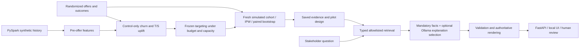

# Customer Retention Uplift & Decision Intelligence System

A synthetic fintech experiment that connects **causal uplift, economic decisions and governed AI explanations**.
Churn predicts who may leave. Uplift asks whose behaviour an offer might change. This project
then asks whether that change covers cost, how uncertain the evidence is, and how to explain it.

**All customers are synthetic; all economics are illustrative. No real campaign, commercial ROI
or production deployment has been demonstrated.**



## What the evidence says

- **25,000 customers and 1,280,055 transactions** were generated and validated for Stage 2;
  historical-only features and customer-level splits protect against leakage.
- Validation selected a T-learner. Stage 3 evaluated its frozen rules on **10,000 new synthetic
  customers**, with seven prespecified financial scenarios and paired bootstrap comparisons.
- Base planning selects **1,500 customers**, spends **£3,000** and predicts **£5,187.17 net**.
  The randomized observed-outcome net estimate is **£3,800**, with a pointwise 95% interval of
  **[−£698.15, £8,308.20]**. The recommendation is **inconclusive: no rollout**.
- The assistant cites exact report fields and preserves that recommendation. Ollama selects up to two additional approved explanations; application code always includes
  mandatory evidence and renders every number and caveat.
  It is deliberately constrained composition, not unrestricted AI analysis.

See [Stage 4 execution results](reports/stage-4-completion.md) for actual local-model performance,
failures, latency and test totals. [Machine-readable evaluation](reports/stage4/evaluation-summary.json)
separates model calls from scope-guard refusals; deterministic answers are never counted as LLM successes.

**Historical LLM baseline:** the basic prompt passed 11/28 supported questions. The bound prompt
passed 2/5 completed questions before the run was stopped under severe memory pressure; its full
benchmark is incomplete. The deterministic suite passed all 44 cases. No prompt superiority or
production reliability is claimed.

**Reliability pass:** the new optional-only contract removes mandatory-ID copying. The new
[report](reports/stage-4-reliability.md) distinguishes model contribution from safe mandatory-only
responses. Live v2 evaluation is resource-blocked so far; no improvement in live success rate is
claimed. Original raw results remain unchanged in `reports/stage4`.

## Run the local explanation demo — Windows CMD

```bat
git clone https://github.com/tabishiqbal03/customer-retention-uplift-system.git
cd customer-retention-uplift-system
git checkout feature/stage-4-governed-ai-assistant
py -3.14 -m venv .venv
.venv\Scripts\activate
python -m pip install -e ".[dev]"
python -m retention_uplift.assistant.cli serve
```

Open **http://127.0.0.1:8000**. Deterministic demonstration is the default. Startup reads the
committed aggregate report; it does not import Spark, train models or regenerate data.
The branch command applies while Stage 4 is awaiting review. Installation is from a repository
checkout (`-e`); the aggregate report is not bundled as standalone wheel package data.

For real local inference, run `ollama list` and verify `qwen2.5:3b` is installed, then select
**Local Ollama** in the UI. No model download is automatic. The tested machine has about 8 GB RAM;
see [setup, five demonstrations and troubleshooting](docs/assistant.md).

```bat
python -m ruff check .
python -m ruff format --check .
python -m pytest -q --basetemp=data/test-full-tmp
python -m retention_uplift.assistant.cli evaluate --output data/assistant-eval --modes deterministic
```

The full tests need Java for real Spark integration. The assistant tests alone use mocked Ollama:
`python -m pytest tests/test_assistant.py -q --basetemp=data/test-assistant-tmp`.
Evaluation uses real Ollama unless `--modes deterministic` is supplied. Always choose a new output
directory. Pytest clears its basetemp; never point it at data you need to keep.

## Methods, evidence and boundaries

| Area | Guide | Executed evidence |
|---|---|---|
| Synthetic data and leakage prevention | [Simulation](docs/simulation.md), [data dictionary](docs/data-dictionary.md) | [Stage 1](reports/stage-1-completion.md) |
| Churn, uplift and held-out policy value | [Modelling](docs/modelling.md) | [Stage 2](reports/stage-2-completion.md) |
| Economics, uncertainty and pilot planning | [Financial decisions](docs/financial-decisions.md) | [Stage 3](reports/stage-3-completion.md), [business brief](reports/stage3/business-summary.md) |
| Governed local explanation service | [Assistant](docs/assistant.md), [evaluation cases](evals/stage4-cases.json) | [Stage 4](reports/stage-4-completion.md) |

[Full pipeline reproduction](docs/pipeline-reproduction.md) · [Operations](docs/operations.md) ·
[Interview guide](docs/interview-summary.md) · [CV wording](docs/cv-summary.md)

The simulator does not establish real-world generalization. Intervals are pointwise and conditional
on fitted rules and assumed economics; they omit training and population-shift uncertainty.
The assistant uses finite English query routing and a reviewed claim catalogue; it can refuse valid
paraphrases and cannot establish arbitrary semantic correctness. Its local API has no authentication,
TLS or production controls. Human review, genuine randomized validation, privacy governance and
business-approved costs would be required before any operational use.
