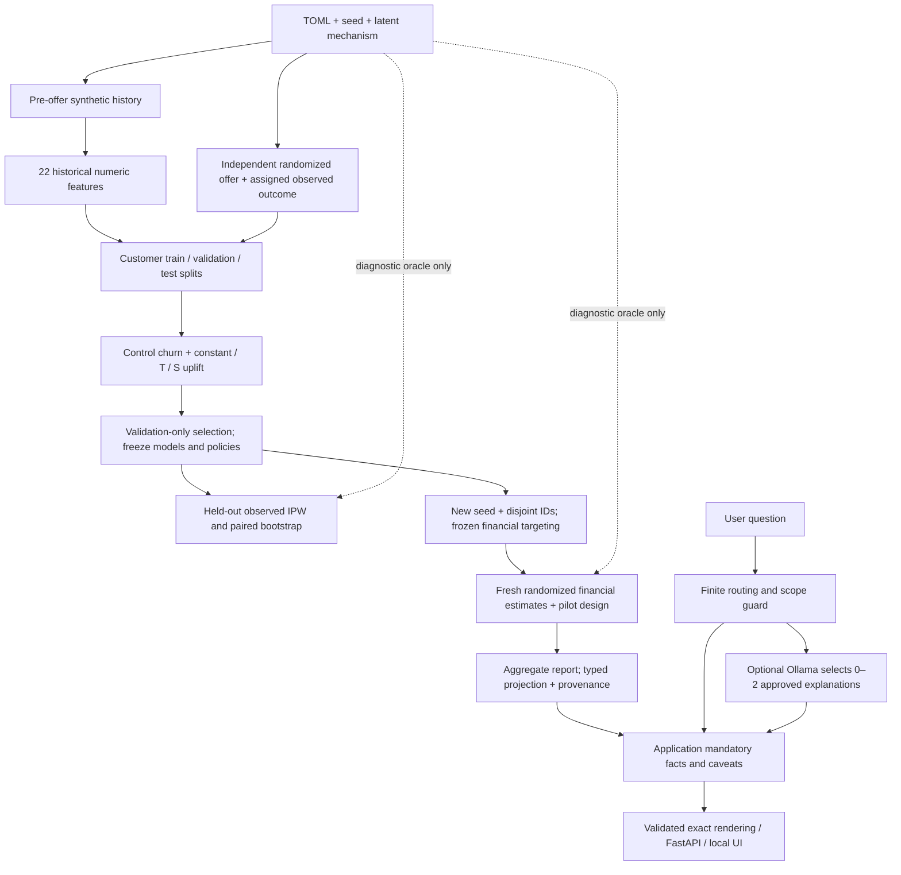

# Final portfolio audit

Audit date: 20 October 2026. Scope: all four merged stages. Baseline independently fetched and checked: [`d77a6a7ab7d401e06714eab84bf4bb4fbb9b743d`](https://github.com/tabishiqbal03/customer-retention-uplift-system/commit/d77a6a7ab7d401e06714eab84bf4bb4fbb9b743d), `main`. This is a new code/evidence review and test execution, not an external certification. Historical completion reports describe their original delivery dates; their former unmerged status is not the current repository state.

## A. Executive verdict

**Ready for graduate applications as a synthetic research and engineering prototype, with a reliable bounded deterministic demonstration.** Its strongest evidence is the connection between a randomized experiment, leakage-aware modelling, constrained decisions, uncertainty and restrained communication. The primary financial conclusion remains inconclusive/no rollout. No real profit, external validity, universal policy superiority or production readiness has been established.

No P0/P1 defect requiring a change to scientific equations or public API was identified in this audit. That is a scoped review finding, not a proof of correctness. The reviewed implementations and analytic/integration tests support the stated estimands. Necessary corrections concern stale setup and portfolio descriptions. The revised live LLM contract has **zero supported live observations**: it is not experimentally validated. Its narrow contribution also limits how strongly this project alone supports an AI-engineering claim.

The independent local full run passed **313 tests in 225.16 seconds**, with one Starlette/HTTPX deprecation warning. A separate current deterministic evaluation passed **44/44** cases (28 supported, 16 guarded), with zero model calls. Neither result measures live model quality. No expensive population generation, training or live benchmark was repeated.

## B. Repository and architecture

| Component | Actual responsibility |
|---|---|
| `configs/*.toml` | Experiment/cohort profiles and explicit economics |
| `config.py`, `randomness.py`, `simulator.py` | Validated chronology, keyed pseudo-random draws, latent mechanism and observed experiment |
| `features.py`, `validation.py`, `storage.py`, `pipeline.py`, `spark.py` | Historical feature allowlist, integrity checks, Parquet readback and Spark lifecycle |
| `modelling_data.py`, `models.py`, `policy.py`, `evaluation.py`, `stage2.py` | Bounded customer arrays, splits, train/validation selection and held-out evaluation |
| `economics.py`, `optimizer.py`, `financial_evaluation.py`, `experiment_design.py`, `stage3.py` | Frozen financial rules, fresh cohort, uncertainty and hypothetical pilot |
| `stage2_reporting.py`, `stage3_reporting.py`, `reports/` | Aggregate evidence, figures and business brief |
| `assistant/{contracts,evidence,claims,engine,ollama,api,cli}.py`, `index.html` | Typed retrieval, controlled composition, optional local model, API and UI |
| `assistant/{evaluate,reliability}.py`, `evals/` | Fixed development cases, saved raw attempts and resource-gated evaluation |
| `tests/`, `.github/workflows/ci.yml` | Numerical, boundary, real Spark/storage and mocked-model tests |

Python modules above reside under `src/retention_uplift/`. Generated datasets, fitted models, split manifests and per-customer decisions remain in ignored `data/`; committed reports are aggregate evidence, not a replacement for those local artifacts.

## C. Stage 1 scientific review

**Mechanism and chronology.** `simulator.py` constructs six equally weighted, overlapping latent archetypes. Engagement/trend and product use influence noisy historical transactions and baseline retention; sensitivity and aversion alter the treatment response. Logistic probabilities keep `p0` and `p1` bounded, with `tau=p1-p0`. Only the assigned arm's observed retention is sampled, followed by a positive activity-day count when retained. The system does not pretend to observe both binary potential outcomes.

Default history is 1 January–31 December 2025; assignment is 1 January 2026; outcomes are 2–31 January. `features.py:build_features` checks both historical boundaries and snapshot dates, uses explicit source columns, and retains customers with no transactions through a left join. The predictor allowlist excludes customer ID, assignment, outcomes, cutoff metadata, archetype labels and oracle values. Future-event and forbidden-column tests exercise this boundary. Shared latent causes linking pre-offer activity to response are intentional learnable signal, not direct label leakage.

**Randomization.** `randomness.py` uses seed/domain/stable-ID keyed SHA-256 draws. Separate domains prevent reusing the same draw for history, treatment and outcomes; row partition/order changes do not determine assignments. The configured propensity is recorded and used downstream, including non-half-propensity tests. This is reproducible simulation, not a certified randomization service. Alphabetic ID prefixes distinguish cohorts; IDs remain grouping/tie-breaking keys and never numeric predictors.

**Integrity and storage.** Validation covers six table schemas, uniqueness, foreign-key/coverage checks, null/nonfinite values, dates, binary outcomes, probability bounds and outcome consistency. Balance warnings do not trigger reseeding. Parquet readback must pass before `_SUCCESS`. Integer-pence moments improve repeatability. Summed row hashes are useful diagnostics, not collision-free content proofs. The Windows portable writer streams Arrow batches (8,192 rows; files rotate at 65,536) through `toLocalIterator`; memory can still contain the largest Spark partition and the sink is serial. Native Spark writes are available elsewhere.

**Evidence and limitations.** Saved smoke evidence has 1,000 customers / 50,524 transactions. Stage 2 generation validation records **25,000 / 1,280,055**; Stage 3 records **10,000 / 519,589**. The 100,000-customer attempt exhausted Java heap during readback, and has not subsequently been established as successful. There is no 10M-event or distributed throughput benchmark. Feature modelling moves a bounded customer matrix to NumPy; Spark does not train the uplift estimators.

The DGP deliberately creates treatment heterogeneity and a manageable feature-response relationship. Balanced archetypes, clean histories, stationary response mechanisms, known propensities and absence of confounding/interference make this more convenient than business data. Sensitivity/aversion remain partly hidden, so oracle effects are not perfectly recoverable from features. No calibrated customer realism, missing-data robustness, population-shift performance, fairness or external causal validity has been demonstrated. These limit interpretation without invalidating the synthetic exercise.

## D. Stage 2 statistical review

`modelling_data.py:split_customers` hashes customer IDs within treatment arms into approximately 60/20/20 disjoint groups, independent of outcome and input order. Saved counts are 14,999 train, 5,000 validation and 5,001 test. These are held-out customers from one synthetic campaign, not temporal validation. The 10,000 and 25,000 development populations overlap in IDs and are not independent replications.

`models.py:select_models` fits standardized logistic churn on **training controls only**, selecting C from 0.1/1 by validation-control Brier. It estimates untreated churn, not response to an offer. The constant baseline estimates the training IPW mean effect. The T-learner fits separate arm classifiers; the S-learner fits one classifier with treatment as a predictor and differences its two predictions. Histogram boosting uses 100 iterations, learning rate .05, minimum leaf 40, L2=10, no early stopping; leaf counts 7/15 are compared.

Selection minimizes validation `mean(prediction² - 2*prediction*Z)`, with `Z=T*Y/e-(1-T)*Y/(1-e)`. This is transformed-outcome squared loss with the common `Z²` term removed. It is unbiased for the corresponding ranking criterion under randomized assignment, but noisy. Saved validation losses select T/7 (-0.0006307214) over S/7 (-0.0004951350); all seven attempted candidates are recorded. There is no test/oracle reselection or validation refit. `stage2.py` writes selection/models and freezes masks before test evaluation, then loads oracle diagnostics separately. This is procedural discipline, not an access-control barrier.

On controls, test churn ROC-AUC is 0.682343 and Brier 0.218189. T's oracle RMSE is 0.133085 and observed Qini area 0.013813; S has lower RMSE 0.126930 and larger Qini 0.016505. Keeping T after observing those test results is correct. Oracle RMSE compares to full latent-state tau, whereas learning targets history-conditional effects; an irreducible-error floor has not been estimated. Qini integrates cumulative IPW gain above its random-ranking diagonal; it is not individual causal accuracy or a standardized commercial uplift percentage.

`policy.py` evaluates frozen policy masks using known-propensity Horvitz–Thompson contributions over **all eligible customers**. In Stage 2, random/churn receive the same count as positive-uplift targeting; their own recipients are not all screened for positive uplift. This differs from Stage 3. Paired customer bootstrap shares each resample across policies, preserving covariance. It keeps fitted scores and masks fixed, does not refit/reselect or enforce an exact budget in every resample, and supplies approximate conditional pointwise percentile intervals. It is neither a finite-population randomization interval nor a simultaneous confidence statement.

The saved test ATE estimate is -0.400 percentage points with interval [-4.520, 3.840]. At 20% outreach, uplift-minus-random and uplift-minus-churn have positive pointwise intervals, but other fractions are unresolved or can reverse. Multiple unadjusted comparisons and selection noise preclude a blanket claim of superiority. Analytic non-half-propensity, expectation-enumeration, paired-covariance, split invariance and leakage tests provide substantive checks; there is no broad CI coverage study.

## E. Stage 3 financial review

**Objective.** `optimizer.py:build_policies` maximizes the sum of selected `uplift*value - (offer_cost+contact_cost)`. With uniform nonnegative contact cost, feasible cardinality is capped by capacity and floor(budget/cost); selecting the largest strictly positive scores is exact for this predicted objective by an exchange argument. Decimal budget division avoids binary rounding that could lose a feasible contact. Zero cost uses capacity only; zero/nonpositive opportunities permit no offer. This is not proof of optimal true decisions, and heterogeneous costs would require a different optimizer.

Value is assumed 30-day contribution, not spend or measured lifetime value. The heterogeneous scenario uses pre-offer activity/product usage to map £40 to £20–£60. All Stage 3 active comparators share the positive predicted-net screen and maximum budget/capacity. Thus “churn” is financially screened churn targeting, not unconstrained high-risk targeting. Fixed value and cost make uplift and profit rankings identical; their equality is expected, not evidence that the optimizer adds monetary lift.

**Freeze and independence.** `stage3.py:run_stage3` verifies trusted model/source fingerprints, requires the selected T-learner, uses a new seed and disjoint prefix/IDs, saves protocol and decision hashes, and freezes masks before loading observed outcomes for evaluation. Oracle diagnostics follow observed evaluation. Generation necessarily creates/validates outcomes, but the decision loader accepts features only. The final 10,000 customers are a separate synthetic draw from the same DGP, not a new real population or time period. A reproduced Stage 2 selecting S is deliberately rejected; users should not silently edit selection to obtain this report.

**Estimand and uncertainty.** `financial_evaluation.py:evaluate_financial` computes total `sum(mask*(value*Z-cost))`. Cost is charged for every proposed recipient, including historical controls, which is correct for the proposed policy's intervention cost. Paired customer bootstrap resamples the whole contribution vector and scales means to cohort N; its conditional, pointwise limitations also apply here. Intervals do not incorporate uncertainty about assumed economics or model training.

| Profit policy scenario | Contacts | Spend £ | Predicted net £ | Observed IPW net £ [95% interval] | Saved decision |
|---|---:|---:|---:|---|---|
| Primary base | 1,500 | 3,000 | 5,187.17 | 3,800 [-698.15, 8,308.20] | Inconclusive/no rollout |
| Low value | 1,495 | 2,990 | 1,093.59 | 490 [-1,784.10, 2,740.65] | Inconclusive/no rollout |
| High value | 1,500 | 3,000 | 13,374.34 | 10,600 [1,637.85, 19,670.20] | Controlled pilot |
| Low cost | 2,500 | 2,500 | 9,135.59 | 4,700 [-1,480.40, 10,599.10] | Inconclusive/no rollout |
| High cost | 84 | 672 | 72.86 | 688 [-304.60, 1,736.20] | Inconclusive/no rollout |
| Unfavourable | 0 | 0 | 0 | 0 [0, 0] | No offer |
| Heterogeneous value | 1,500 | 3,000 | 7,536.55 | 6,950 [797.72, 13,090.77] | Controlled pilot |

These values were reread from [metrics.json](stage3/metrics.json). Base profit-minus-churn is £880 [-£3,210.05, £5,044.30]; profit-minus-random is £6,480 [£1,650.75, £11,710.80]; profit-minus-uplift is zero. None converts the primary interval into proof of positive profit. High-value/heterogeneous sensitivities do not replace the prespecified primary case. Oracle expected money is diagnostic only; neither expected nor IPW money is realised business profit.

`experiment_design.py:sample_size` implements an approximate two-sided two-proportion normal calculation including allocation ratio. Baseline .60, alternative .63, alpha .05 and power .80 yield **4,129 per arm / 8,258 total**. Saved 20,000-replicate Monte Carlo pooled-z checks yield power .8014 (MC SE .002821) and type-I .0481 (SE .001513). This tests offer efficacy within the frozen target population, not superiority of complete targeting strategies or profit power. The base 1,500-person target list cannot itself supply 8,258 participants; recruitment/eligibility, outcome horizon and guardrails would need agreement. Analytic size and brute-force small optimizer tests support the implementation. No consequential mathematical correction was identified.

## F. Stage 4 AI engineering review

`EvidenceStore` reads a fixed checkout-relative Stage 3 report, validates a typed allowlisted projection, exposes approved fields and attaches the artifact SHA-256 and field path to facts. Arbitrary report fields and oracle data are withheld. Source bytes remain trusted local input: a hash provides traceability, not authorship/authenticity. Schema consistency is not a proof the underlying study is scientifically valid.

The engine determines mandatory facts and caveats; Ollama may select zero to two approved optional conceptual explanations. Strict ID validation rejects unknown, duplicate, malformed or excessive choices, and authoritative rendering controls numbers. An empty selection is safe but provides no additional model explanation. Model errors are returned explicitly; selecting deterministic mode is manual. There is no automatic successful LLM-to-deterministic fallback. This is controlled catalogue composition; it does not demonstrate general retrieval-augmented synthesis, autonomous reasoning, agent tool use or trained language modelling.

The HTTP adapter uses loopback only, disables environment proxies and redirects, checks a locally installed non-remote model, bounds response bytes and limits output/context. The engine uses a per-process inference lock. Invalid plans get one constrained retry; transport errors do not. The 60-second HTTP timeout is not a strict end-to-end deadline. The benchmark's 100-second subprocess watchdog does not guarantee cancellation inside Ollama. Its memory gating applies to the benchmark, not every API request.

API endpoints are health, report summary, explanation, evidence, historical evaluation summary and UI. Requests use strict fields and approved scenario names; the ASGI body cap measures actual chunks. Startup does not train/import Spark or probe inference. Health honestly says Ollama is unprobed. UI text rendering uses `textContent`, exposes modes and errors, and labels historical metrics. The finite English router can refuse legitimate paraphrases or match unintended wording; semantic correctness is bounded by the catalogue and routing, not proven by keyword guards.

Raw JSONL was independently counted:

| Evidence | Supported cases | Supported passes | Other results | Interpretation |
|---|---:|---:|---|---|
| Historical deterministic | 28 | 28 | 16 guarded; 44 total passed | Fixed development suite |
| Historical basic live prompt | 28 | 11 | 16 guards; 27/44 total | Poor supported reliability |
| Historical bound live prompt | 5 completed | 2 | Remaining 39/44 uncompleted | Incomplete; no prompt superiority |
| Revised optional-only live | 0 attempted | 0 | 16 guards; memory gate stopped inference | Live success/latency unknown |
| Current audit deterministic | 28 | 28 | 16 guards; 44/44 passed, zero calls | Current bounded demo verified |

Historical basic supported latency was median 39.775 seconds; the bound run reached 247.811 seconds maximum. Those are measurements of the former contract, not the revised one. Smaller prompts are not evidence of improved wall-clock inference. Tests with mocked optional selections exercise protection but cannot predict which IDs a real model chooses, or whether users find those additions useful. The development cases are not held-out linguistic/generalization evidence.

`reliability.py:benchmark/recover` freezes case/report/protocol hashes and options but not implementation revision or installed model digest. It trusts saved pass/check fields when resuming. A future resumed benchmark could mix implementations under the same tag unless operators retain the environment. Before making new live comparisons, add provenance checks and revalidate recovered rows in a separately approved change. Existing v2 has no supported live data, so this does not invalidate a claimed success rate: none exists. Historical files remain unchanged.

## G. Software engineering and reproducibility

The src-layout modules separate generation, modelling, decisions and explanation. Configuration, strict artifact ordering, refusal to overwrite data, bounded numerical threads, local outputs and focused integration tests are practical strengths. Failure handling is clearer than a single notebook pipeline. The system is still a local batch prototype with fixed report/schema assumptions, not an operational platform.

Direct runtime/dev dependencies are pinned. `requires-python` declares >=3.12; verified local/CI interpreter is 3.14, and this audit does not establish all versions in that range. There is no transitive lockfile, SBOM, dependency vulnerability assessment or version/platform matrix. The lint target is py311, which is more permissive about compatibility than evidence of execution. CI installs afresh on Ubuntu with Python 3.14 and Java 25 and runs lint, formatting and full tests. Action version tags are not immutable commit pins.

The documented editable checkout is important: the default assistant report is not bundled in a wheel. Deterministic serving does not require Java or Ollama at runtime, but installation still pulls the full project dependency stack. Full tests need Java/Spark. A fresh production-size reproduction was not run; existing local virtualenv success is not a clean-install claim. New CI supplies clean-install evidence on its configured environment only.

The 313 tests include 88 data/modelling/financial tests and 225 assistant tests. In particular, 112 combinations are 28 supported cases times four optional-selection variants, not 112 independent adversarial questions. Meaningful tests include leakage injection, real Parquet readback/file rotation, non-half IPW expectations, optimizer enumeration, allocation-ratio power checks, freeze/read ordering, request-size errors and no-call guards. They are not a coverage percentage, proof of inference correctness, load test, penetration test or live LLM benchmark. A small Stage 3 fixture forces a T-model bundle if necessary to exercise orchestration; that fixture does not establish T's scientific selection win.

## H. Security and responsible AI

Implemented: loopback default binding, trusted-host checks, body/output bounds, strict schemas, allowlisted evidence/IDs, safe text rendering, controlled errors, no model shell/file/network tools, no automatic model download and explicit human review. Synthetic customer data and aggregate-only committed artifacts reduce exposure. A tracked-file scan found no `.env`, Parquet, joblib or NPZ artifacts; a targeted source/test/doc/report-text scan found no matching common GitHub/OpenAI token patterns or user-home paths. This was not an exhaustive secret-history or vulnerability scan.

Remaining: no authentication, TLS, rate limiting, persistent security audit trail, tenant isolation, production monitoring or incident response. Host checking is not authentication. Trusted joblib deserialization can execute code; only locally trusted model artifacts are acceptable. A user who can replace the approved report can alter the evidence. Local-model output restriction is stronger than keyword prompt-injection screening, but cannot establish universal injection resistance. Real financial deployment would require lawful data use, access controls, subgroup/harms review, independent experimentation and business-approved economics. These are deployment prerequisites, not reasons to embellish this portfolio's scope.

## I. Portfolio assessment by target role

These are qualitative assessments against common early-career work examples, not hiring probabilities, market percentiles or claims about all applicants. The user's degrees and battery-telemetry/SQL/Power BI internship provide complementary experience; this repository does not itself verify that experience.

| Role | Demonstrated strengths / early-career positioning | Missing evidence and likely interviewer challenge | Emphasize |
|---|---|---|---|
| Graduate Data Scientist | Strongest fit: experimental estimands, validation discipline, uncertainty and decisions extend beyond a classifier notebook | Real data, causal assumptions under observational assignment, temporal validation, model/CI sensitivity; “Why does S look better on test?” | Keep validation-selected T, explain oracle versus CATE and conditional intervals |
| Graduate ML Engineer | Useful batch engineering, contracts, reproducible stages, bounded resource handling and CI | Deployment, orchestration, model registry/versioning, drift, load and distributed performance; “What fails at 100k?” | Honest scale ceiling, freeze hashes, storage tests, bounded driver matrix |
| Applied AI Engineer | Credible constrained API integration and failure/provenance design beyond a chat wrapper | Current live reliability and model utility unmeasured; no general retrieval or agent system; “What does the LLM actually add?” | Optional catalogue selection and the trade-off; demonstrate deterministic mode clearly |
| Data Analyst | Strong analytical storytelling, scenario distinctions and uncertainty-aware recommendations | No SQL/BI implementation here or real stakeholder feedback; “What action follows an inconclusive result?” | Business brief and pilot design; use internship for SQL/Power BI evidence |
| AI/Data Consultant | Good framing from churn to intervention value and evidence-gated action | Client discovery, deployment economics, adoption and regulatory delivery untested; “Which assumptions must a client validate?” | Cost/value assumptions, no-rollout result, prospective validation plan |
| General Software Engineer | Modular Python, API contracts, error paths and meaningful tests | Broader app design, auth, concurrency at scale, databases, accessibility and operational ownership; “Why checkout-relative assets?” | Explicit local scope and maintainable interfaces, not production maturity |

For graduate Data Science this can be a flagship technical discussion. For Applied AI it is a credible supporting flagship only when its narrow model role and unmeasured current live behavior are explicit. Avoid adding unnecessary features to disguise those limits.

## J. Ranked issue register

P0 = critical invalidation/security exposure in intended scope; P1 = consequential calculation/design/contract defect; P2 = credibility/reproducibility improvement; P3 = optional future maturity. Effort estimates are indicative engineering time, not commitments. Python paths below are relative to `src/retention_uplift/` unless prefixed with `docs/`, `reports/` or a root file name.

| Priority / status | Exact location and evidence | Why it matters / proposed action | Effort | Portfolio publication blocker? |
|---|---|---|---|---|
| P0: none identified | Reviewed paths and executed checks in C–H/O | No critical finding in the stated local synthetic scope | — | No |
| P1: none identified | `models.py:select_models`, `optimizer.py:build_policies`, `financial_evaluation.py:evaluate_financial`, `experiment_design.py:sample_size` | No consequential scientific/API change justified. Seek approval before any later such correction | — | No |
| P2: fixed | README demo; `docs/pipeline-reproduction.md` quick start still checked out a merged feature branch | Use main and label 100k resource failure at the command, avoiding misleading onboarding | <1 h | Resolved |
| P2: fixed | `docs/cv-summary.md` optional bullet and `docs/interview-summary.md` LLM sections described fallback/mandatory-ID selection and incomplete comparison ambiguously | Describe actual optional-only contract, manual mode and measured denominators | <1 h | Resolved |
| P2: fixed | `docs/operations.md` claimed minimum 3.11, no NumPy application code and only aggregate driver collection; current package/code contradict this | Correct to declared >=3.12, Stage 2/3 arrays and tested scale; contextualize Stage 2/3 scope docs | <1 h | Resolved |
| P2: open evidence gap | `reports/stage4-reliability-v2/summary.json`: supported_total=0; `assistant/ollama.py:generate` | Revised model utility/success/latency unknown. Benchmark separately on adequate hardware with frozen code/model, held-out cases and explicit contribution metrics | 0.5–2 d plus hardware | No if disclosed; yes for “validated live LLM” claim |
| P2: deferred hardening | `assistant/reliability.py:benchmark/recover`: no code/model digest; saved checks trusted | Freeze implementation/model identity and validate resumed rows before future live comparisons | 0.5–1 d | No for preserved evidence; prerequisite for stronger resumed benchmark claims |
| P2: bounded packaging | `assistant/evidence.py:EvidenceStore`, `assistant/api.py:evaluation`, `pyproject.toml` package data | Checkout-relative reports require editable installation; standalone wheel cannot reproduce default demo. Keep explicit setup; package fixtures only if distribution becomes a goal | 0.5 d | No for documented checkout |
| P2: reproducibility limit | `pyproject.toml`, `.github/workflows/ci.yml` | Direct pins only and one CI interpreter; no transitive lock/matrix. Capture locks/environment for future releases | 0.5–1 d | No; don't claim universal reproducibility |
| P2: scale limit | `reports/stage2/scale-attempts.json`, `storage.py` portable sink | 100k failed and serial sink/driver matrix impose limits. Benchmark only if larger-scale claim needed | Hardware-dependent | No; current claims limited to 25k |
| P3: production prerequisites | `assistant/api.py:create_app`, `assistant/cli.py:main`, trusted `stage3.py` model loading | Auth, access control, observability, model/report trust and deployment design needed before operational exposure | Several days/weeks | No portfolio blocker; production blocker |
| P3: scientific extension | `policy.py`, `financial_evaluation.py`, `simulator.py` | CI coverage, retraining uncertainty, multiplicity, real/temporal data and subgroup review would strengthen external claims | Study-dependent | No synthetic blocker; real-business claims unsupported |

No core behavior was changed to address deferred issues, and no new substantive approval is needed for this documentation-only delivery.

## K. Changes made

Added this audit. Updated README discovery and merged-main setup; clarified that deterministic runtime avoids Java/Ollama but installation includes the full stack. Updated pipeline reproduction to distinguish generation from validation and label unverified 100k commands. Corrected operations' Python, NumPy and collection claims. Updated methodology cross-links to reflect the later merged stages. Replaced CV wording with role-specific versions and corrected interview explanation of the current contract and incomplete historical benchmark.

No source, test, dependency, model, numerical report, historical benchmark, scenario, policy or API contract was changed. Historical stage completion reports retain their original evidence and delivery-time claims, with the README explaining their historical status. Verification and delivery details follow below.

## L. Final README assessment

The opening now explains the business question and synthetic boundary before the diagram, main results, quick demo and methods table. The key primary interval and no-rollout recommendation are visible; historical live failures and the revised resource block are explicit. A reviewer can reach the audit, methodology, business brief, CV and interview material directly. Setup now targets main. This is suitable for an initial portfolio review without hiding difficult findings.

The project remains technically dense. In an interview, open the deterministic demo and business brief first, then trace one quoted value to its report field and one policy estimate to its formula. Do not lead with “313 tests” as a proxy for business validity or with synthetic monetary totals as impact.

## M. CV wording

Project title for all versions: **Customer Retention Uplift & Decision Intelligence System — synthetic portfolio project**.

**Data Science.** Stack: Python, PySpark, NumPy, scikit-learn, SciPy, Matplotlib, PyArrow, pytest.

- Built a randomized synthetic retention experiment with 25,000 customers and 1,280,055 transactions; compared control-only churn and T/S uplift models using validation-only selection and held-out policy evaluation.
- Evaluated frozen budget-constrained targeting on 10,000 new simulated customers using IPW and paired bootstrap intervals; retained an inconclusive/no-rollout recommendation when the primary net-value interval included zero.

**Applied AI Engineering.** Stack: Python, FastAPI, Pydantic, HTTPX, Uvicorn, local Ollama/qwen2.5:3b, HTML/CSS/JavaScript, pytest.

- Built a local evidence explanation API/UI with typed report projections, field-level provenance, authoritative numeric rendering and application-controlled uncertainty statements.
- Constrained optional Ollama output to approved explanation IDs and tested validation, refusals and failures; preserved an incomplete historical benchmark and distinguished deterministic demonstration from unmeasured revised live performance.

**Analytics / Consulting.** Stack: Python, PySpark, NumPy, SciPy, Matplotlib, Markdown/HTML reporting.

- Translated synthetic uplift estimates into seven illustrative contribution/cost scenarios, budget and contact constraints, and a stakeholder decision brief.
- Communicated predicted value versus uncertain randomized-outcome estimates; designed an 8,258-customer hypothetical pilot for offer efficacy within the target population.

## N. Interview preparation

1. **Why keep T when S looks better on test?** T won the prespecified validation criterion; switching after seeing test diagnostics would use the test set for selection. The difference also illustrates noisy selection and a synthetic oracle target containing hidden heterogeneity. A future model-selection study needs new evaluation data, not rewriting this result.
2. **Is your bootstrap a confidence interval for the deployed campaign's profit?** It is a pointwise approximate interval for a frozen policy's randomized-outcome value under the synthetic population and assumed costs/values. It excludes model-selection/retraining, value estimation, shift and many deployment risks. Shared resamples correctly retain covariance between policy contrasts; it is not prospective realised-cash certainty.
3. **Why does profit targeting equal uplift targeting, and did you make churn unfair?** With fixed positive value and uniform cost, profit is a monotone transformation of uplift, so rankings coincide. All Stage 3 comparators share the positive-net screen, so the comparison is specifically against screened churn/random policies. Heterogeneous values can change the ranking; heterogeneous costs require a different optimization method.
4. **What would the proposed pilot establish?** At the assumed .60 baseline, .03 effect, .05 alpha and .80 target power, the normal design requires 4,129 per arm. It tests offer efficacy among eligible targeted customers. It does not test complete targeting-strategy superiority or power financial profit; the available target list is too small, and real recruitment, harms and contribution assumptions must be specified.
5. **Why have an LLM if the application controls the answer?** The model has only the optional task of choosing useful approved conceptual additions. That bounds numeric hallucination but limits flexibility and unproven utility. Historical basic performance was 11/28 supported; the revised live contract has no measurements. I would demonstrate deterministic mode honestly and test additional model value before claiming the LLM is necessary or improved.

## O. Verification results

Executed on the existing Windows checkout/venv with Python 3.14.3. Commands below use `python` for readability; execution used `.venv\Scripts\python.exe`.

| Check | Result |
|---|---|
| Fetch origin main, fast-forward local main, inspect HEAD/history | Baseline exactly d77a6a7; clean before documentation changes |
| `python -m pytest -q --basetemp=data/final-audit-test --junitxml=../final-audit-tests.xml` | 313 passed, 0 failures/skips, 225.16s; one StarletteDeprecationWarning about HTTPX TestClient |
| `python -m retention_uplift.assistant.cli evaluate --output data/final-audit-deterministic --modes deterministic` | 44/44 passed; 28 supported and 16 guard cases; zero live requests/model calls |
| `python -m retention_uplift.assistant.cli --help` and `python -m retention_uplift.cli --help` | Both successful; documented command families present |
| `python -m pip check` | No broken requirements |
| `python -m ruff check .` | Passed |
| `python -m ruff format --check .` | 60 files already formatted |
| Parse committed selection/financial JSON and historical JSONL | Selection, seven financial rows, pilot totals and live denominators checked against this report |
| Targeted tracked-artifact/token/path scan | No matched credential patterns or ignored data/model formats tracked; limited scan, not security certification |

The full tests ran before documentation edits; executable code is unchanged. No new browser visual test is claimed in this audit: API/UI routes and rendering guards are tested, and source reviewed; earlier browser execution belongs to historical evidence. No live Ollama calls/downloads, 100k retry, full cohort regeneration, retraining, fresh local dependency installation, wheel portability test, performance/load study or penetration test was run. Those omissions are explicit and do not turn mocked/deterministic results into live evidence. Final diff/link and CI verification are recorded in Q.

## P. Final publication recommendation

| Claim | Verdict |
|---|---|
| Portfolio-ready synthetic research/engineering prototype | **Yes**, with this audit and corrected wording. Appropriate for graduate applications; discuss limitations without presenting synthetic results as commercial impact |
| Reliable local deterministic demonstration | **Yes within the documented checkout and supported catalogue**, supported by current tests and 44-case evaluation; not a universal natural-language service |
| Experimentally validated revised live LLM | **No**. Zero supported live attempts under the revised contract; historical basic reliability is poor and bound comparison incomplete |
| Production-ready business system | **No**. Real randomized validation, economics, privacy/security, operations and deployment engineering remain necessary |

Publish the bounded project now rather than inventing business impact or delaying applications for speculative features. Keep the primary inconclusive result and failed/incomplete benchmarks visible. Any next work should answer a specific evidence gap, particularly whether live optional selection adds useful value.

## Q. GitHub delivery

Audit branch: `audit/final-portfolio-readiness`, based on the verified main commit above. Delivery is documentation-only; the pull request remains unmerged for user review. The PR commit list is the canonical final revision; a commit cannot contain its own hash. 

- [Pull request #5](https://github.com/tabishiqbal03/customer-retention-uplift-system/pull/5): open for review; do not merge automatically.
- [Audit content commit f9890b7](https://github.com/tabishiqbal03/customer-retention-uplift-system/commit/f9890b7bbf9d6e86e77d661e555e56a529daeda2); [canonical final commit list](https://github.com/tabishiqbal03/customer-retention-uplift-system/pull/5/commits).
- [Initial audit CI run](https://github.com/tabishiqbal03/customer-retention-uplift-system/actions/runs/39452154064); [final revision checks](https://github.com/tabishiqbal03/customer-retention-uplift-system/pull/5/checks). CI is pending at this documentation commit; the delivered report/chat records its subsequently verified result.
- `git diff --check` and a local-link scan of all eight changed Markdown files passed. A comparison with baseline confirmed no executable source/tests or historical report artifacts changed.

