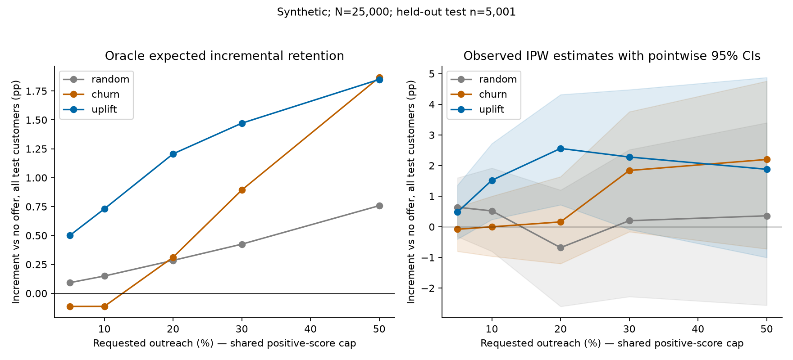

# Stage 2 completion report

All numbers below come from saved executed-run metrics, not illustrative examples.

## A. Implementation summary

Added modelling_data.py (bounded Spark joins, allowlist, keyed splits), models.py (control-only logistic churn, constant IPW effect, T/S gradient boosting and validation selection), policy.py (equal-count decisions, IPW and paired bootstrap), evaluation.py (final control/oracle diagnostics), stage2.py and stage2_reporting.py (artifacts and four figures). Extended the CLI with run-stage2, added medium/evaluation profiles, tests and docs/modelling.md; updated README, dependencies, ignore rules and CI. No later-stage services or optimization were implemented.

Stage 1 was verified merged at aeec3a3 before branching. One minimal resource-lifetime fix releases generation caches before validating disk copies. The existing real I/O integration test now asserts caches are released before readback, preserving all its prior assertions. No simulation equations, feature definitions, original tests or random assignments were removed.

## B. Data and split details

Main verified population: **25,000 customers**, **1,280,055 transactions**, 22 predictors; **5,001 untouched test customers**. All six tables passed structural and Parquet readback checks. Dates remain 2025 history, 1 January 2026 assignment and 2–31 January outcomes. Generation seed 20261019; split/model/policy/bootstrap seeds 20261020/20261021/20261022/20261023.

| Split | Customers | Treated | Control | Retained | Retention rate |
|---|---:|---:|---:|---:|---:|
| train | 14999 | 7532 | 7467 | 8937 | 0.5958 |
| validation | 5000 | 2511 | 2489 | 2978 | 0.5956 |
| test | 5001 | 2511 | 2490 | 2956 | 0.5911 |

Membership is customer-level 60/20/20 within treatment arms, independent of outcomes and input row order. Per-arm event counts are in metrics.json; the full split manifest is local under ignored data/. The test represents the same synthetic campaign, not future periods.

## C. Modelling results

Control test n=2490; churn prevalence=0.4044. Logistic ROC-AUC=0.682343, average precision=0.579805, Brier=0.218189. Confusion matrix (rows actual, columns predicted; labels non-churn/churn; threshold .5): `[[1202, 281], [574, 433]]`.

Validation selected **t** overall; family leaf counts `{'t': 7, 's': 7}`, churn C=0.1. Five uplift candidates and two logistic C values were compared; complete attempted parameters/losses are saved in selection.json. The selected models remain fitted on training only. Neither test nor oracle values were used in selection.

## D. Causal evaluation

All effect errors and means are probability units; multiply by 100 for percentage points.

| Model | Oracle MAE | Oracle RMSE | Predicted mean | True mean | Spearman | Observed Qini area |
|---|---:|---:|---:|---:|---:|---:|
| constant | 0.105570 | 0.134480 | 0.045736 | 0.013578 | undefined | -0.000687 |
| t | 0.102323 | 0.133085 | 0.034140 | 0.013578 | 0.2048 | 0.013813 |
| s | 0.095338 | 0.126930 | 0.022553 | 0.013578 | 0.2446 | 0.016505 |

Test IPW ATE: -0.400 [-4.520, 3.840] percentage points (95% CI). Qini is the integrated cumulative propensity-weighted gain above its random-ranking diagonal, not individual causal-effect accuracy. Oracle RMSE includes inaccessible latent heterogeneity. Observable-feature CATE and full-state oracle tau are different targets; an irreducible-error floor was not estimated. Ranked-group calibration and curves are saved alongside metrics.

At 25,000 customers, S has lower oracle RMSE and a larger observed Qini area than T. Those test diagnostics do not trigger model reselection: T remains the operational rule because it won the prespecified validation criterion. This distinction avoids post-test cherry-picking.

The 10,000-customer engineering run selected s; all its paired policy intervals included zero despite favourable oracle diagnostics at some budgets. Observed IPW estimates retain outcome/assignment noise that oracle expectations remove. The same prespecified models were used at 25,000; scales overlap in customer IDs and are not independent replication studies.

## E. Targeting policies

All entries use the same held-out test customers. Estimates are incremental retention over no offer, averaged over the entire test population, in percentage points. Actual counts are shared between policies, capped at positive scores of the validation-selected uplift model. Historical randomized assignment is not changed.

| Policy / requested fraction | Actual count | IPW estimate [95% CI], pp | Oracle expected pp |
|---|---:|---|---:|
| random@0.05 | 250 | 0.640 [-0.320, 1.601] | 0.093 |
| churn@0.05 | 250 | -0.080 [-0.800, 0.641] | -0.113 |
| uplift@0.05 | 250 | 0.480 [-0.401, 1.361] | 0.502 |
| random@0.1 | 500 | 0.520 [-0.800, 1.920] | 0.150 |
| churn@0.1 | 500 | 0.000 [-0.960, 1.000] | -0.113 |
| uplift@0.1 | 500 | 1.520 [0.240, 2.720] | 0.730 |
| random@0.2 | 1000 | -0.680 [-2.599, 1.200] | 0.285 |
| churn@0.2 | 1000 | 0.160 [-1.201, 1.640] | 0.312 |
| uplift@0.2 | 1000 | 2.559 [0.719, 4.319] | 1.206 |
| random@0.3 | 1500 | 0.200 [-2.280, 2.519] | 0.425 |
| churn@0.3 | 1500 | 1.840 [-0.161, 3.759] | 0.893 |
| uplift@0.3 | 1500 | 2.280 [-0.081, 4.479] | 1.471 |
| random@0.5 | 2500 | 0.360 [-2.560, 3.399] | 0.758 |
| churn@0.5 | 2500 | 2.200 [-0.720, 4.759] | 1.867 |
| uplift@0.5 | 2500 | 1.880 [-1.002, 4.879] | 1.850 |
| no_offer | 0 | 0.000 [0.000, 0.000] | 0.000 |

Paired customer-bootstrap differences (uplift minus comparator), pp:

- uplift@0.05 - random@0.05: -0.160 [-1.361, 1.081].
- uplift@0.05 - churn@0.05: 0.560 [-0.680, 1.680].
- uplift@0.1 - random@0.1: 1.000 [-0.800, 2.599].
- uplift@0.1 - churn@0.1: 1.520 [-0.160, 2.999].
- uplift@0.2 - random@0.2: 3.239 [1.080, 5.520].
- uplift@0.2 - churn@0.2: 2.400 [0.320, 4.480].
- uplift@0.3 - random@0.3: 2.080 [-0.601, 4.720].
- uplift@0.3 - churn@0.3: 0.440 [-1.760, 2.522].
- uplift@0.5 - random@0.5: 1.520 [-1.561, 4.639].
- uplift@0.5 - churn@0.5: -0.320 [-2.519, 1.800].

Positive pointwise intervals: ['uplift@0.2 - random@0.2', 'uplift@0.2 - churn@0.2']. Negative pointwise intervals: none. Remaining differences are unresolved at this interval level. These are unadjusted multiple comparisons; no blanket policy-superiority claim is made. Bootstrap uses 1,000 shared customer resamples with policies and models frozen, preserving pairwise covariance. It excludes model-training/selection and future threshold uncertainty. Oracle cohort expectations have no outcome-sampling error and do not replace observed intervals.



Other figures: [control calibration](stage2/evaluation/churn-calibration.png), [oracle uplift calibration](stage2/evaluation/uplift-calibration.png), [observed gain curves](stage2/evaluation/observed-gain.png).

## F. Testing

**56 tests passed in 213.96 seconds**, including all 35 original Stage 1 tests and 21 Stage 2 tests. This includes real Spark generation, Parquet readback, modelling, policy evaluation, report production and the cache-release regression assertion. Ruff lint/format, git diff --check and pip check passed. The integration profile has 160 customers/five iterations and is a mechanics test, not performance evidence.

```bat
python -m pip install -e ".[dev]"
python -m pip check
python -m ruff check .
python -m ruff format --check .
python -m pytest -q --basetemp=data/stage2-final-tests
python -m retention_uplift.cli generate --config configs/medium.toml --output data/medium
python -m retention_uplift.cli run-stage2 --input data/medium --output data/stage2-medium
python -m retention_uplift.cli generate --config configs/evaluation.toml --output data/evaluation
python -m retention_uplift.cli run-stage2 --input data/evaluation --output data/stage2-evaluation
```

Actual local commands used .venv/Scripts/python.exe. Aggregate JSON matches the generated summary tables; all four plots were visually inspected. Original tests were not skipped or weakened. Use fresh output paths when reproducing.

## G. Performance and environment

Executed on Windows-11-10.0.26200-SP0, Python 3.14.3, Java 25.0.2. Resolved packages: `{'numpy': '2.5.4', 'scikit-learn': '1.9.1', 'scipy': '1.18.1', 'matplotlib': '3.11.2', 'pyspark': '4.2.0', 'pyarrow': '26.0.0', 'joblib': '1.6.0'}`. Spark local[2], portable writer, 32 partitions for 25,000 customers. Model numerical threads limited to two.

10,000: generation/readback 115.83s; model workflow before rendering 46.31s. 25,000: generation/readback 200.73s; model workflow before rendering 27.32s. Parquet bytes at 25,000: 20,954,249; dense predictor matrix 4,400,000 bytes (not peak process RAM). Historical transactions are never collected into driver Python.

100,000 was attempted and failed with Java heap exhaustion during readback validation; no success manifest was produced and those partial files were not used for modelling. A machine-wide snapshot reported 8,148,984 KiB total and 624,628 KiB free RAM. Heap size was not increased. After the cache-lifetime fix, 25,000 completed; 100,000 was not retried and must not be described as verified. No 10M-transaction benchmark was run. Full process peak memory and failed-run exact elapsed time were not instrumented.

## H. Scientific limitations

All fintech customers, history, offers and randomization are simulated. Effect assumptions are designed, not calibrated to real customers. Latent variables partly determine oracle effects; exact individual recovery is not guaranteed. Oracle values are unavailable in real deployments. Selection is deliberately modest but noisy. Test results concern held-out customers from the same experiment, not later campaigns or real fintech populations. No real retention improvement, ROI, campaign profitability or production readiness is demonstrated. Practical use requires real randomized evidence, privacy controls and domain-specific validation. Physical file separation is not a security boundary.

## I. GitHub delivery

Branch: `feature/stage-2-uplift-modelling`, based on merged Stage 1 main commit `aeec3a3`. Final commit, PR URL and CI status are recorded in the delivered chat report after publishing. The PR must remain open and unmerged. Generated datasets, fitted binaries, manifests and per-customer scores are excluded from Git; only source, tests and aggregate evidence are tracked.

## J. Stage 3 readiness

The tested model and policy-evaluation interfaces can support a separately approved Stage 3. No known failing test remains at the verified scale. Financial optimization and experiment planning require explicit future cost/value assumptions and treatment of current uncertainty; no present finding establishes campaign profitability. The 100,000-customer resource limit remains unresolved. Stage 3, monetary optimization, power planning and deployment are not implemented.

Machine-readable sources: [main metrics](stage2/evaluation/metrics.json), [medium metrics](stage2/medium/metrics.json), [scale attempts](stage2/scale-attempts.json). See [modelling protocol](../docs/modelling.md) for equations, assumptions and exact defaults.
