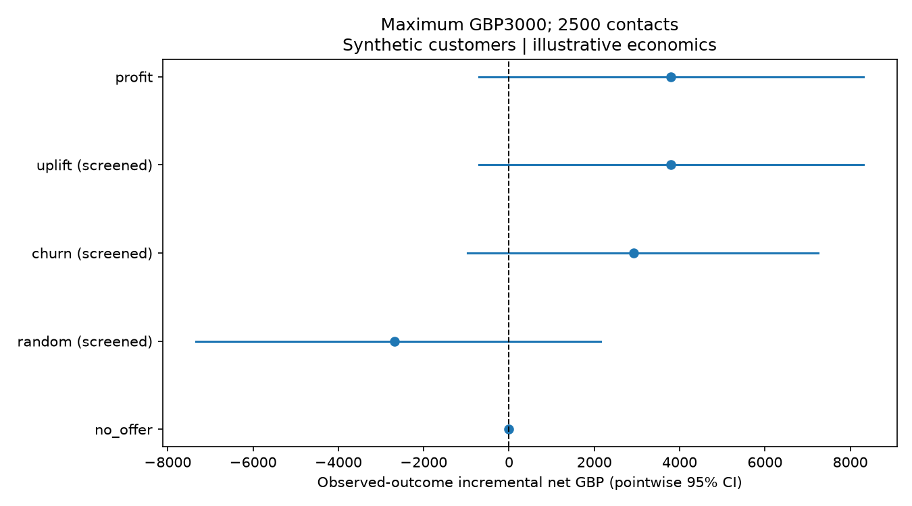
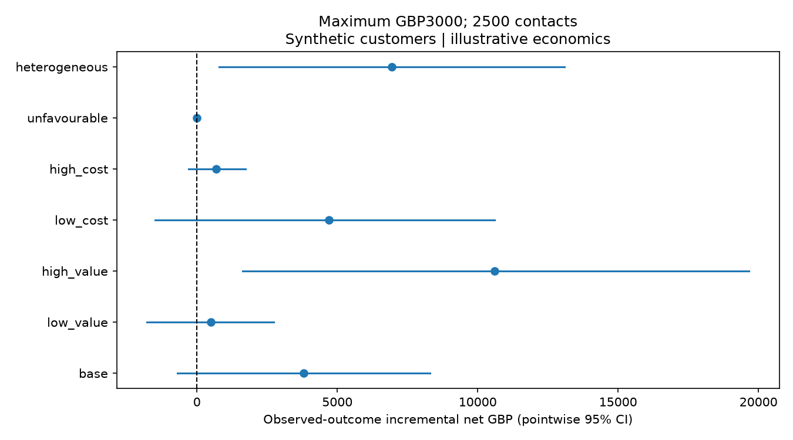

# Stage 3 completion report

All results below come from the executed fresh synthetic cohort. All monetary assumptions are illustrative GBP; no real commercial impact is claimed.

## A. Implementation summary

Added economics.py (validated configuration and historical value mapping), optimizer.py (uniform-cost exact selection and screened comparators), financial_evaluation.py (IPW money and paired bootstrap), experiment_design.py (normal sample size and Monte Carlo), stage3.py (protocol/data/decision freeze ordering), and stage3_reporting.py (four figures and printable business brief). Extended CLI, added economic/cohort TOML profiles, tests and financial methodology. Stage 1 now accepts an optional alphabetic customer ID prefix; its default C preserves prior generation. Stage 2 training and evaluation code is unchanged. Branch starts from merged Stage 2 main df2db54.

## B. Economic assumptions

All values are assumed 30-day net contribution per incremental retained customer, not customer spending, bank revenue or measured CLV. Cost is paid per proposed recipient regardless of retention or historical treatment. Budget maximum GBP3000; contact maximum 2500. No requirement to spend all money. Values are deliberately transparent examples, not calibrated industry benchmarks.

| Scenario | Value GBP | Offer GBP | Contact GBP | Break-even uplift |
|---|---:|---:|---:|---:|
| base | 40.00 | 1.50 | 0.50 | 5.0% |
| low_value | 20.00 | 1.50 | 0.50 | 10.0% |
| high_value | 80.00 | 1.50 | 0.50 | 2.5% |
| low_cost | 40.00 | 0.50 | 0.50 | 2.5% |
| high_cost | 40.00 | 7.50 | 0.50 | 20.0% |
| unfavourable | 10.00 | 11.50 | 0.50 | 120.0% |
| heterogeneous | 20–60 | 1.50 | 0.50 | customer-specific |

Heterogeneous value = 40*(.5+.5*active_months/12+.5*products_used/3), using only pre-offer usage. No spend-to-profit conversion. At zero value no strictly positive net opportunity exists, including a free offer; C/V is reported undefined.

## C. Financial optimisation

Maximize sum(target*(predicted_uplift*value-cost)) subject to binary decisions, spend <= budget and count <= capacity. Uniform cost is mandatory. Select the largest strictly positive scores up to min(capacity,floor(budget/cost)); at zero cost only capacity binds. Decimal budget arithmetic prevents binary floating point from losing feasible contacts. An exchange argument establishes optimality for this predicted objective; no claim of optimal true economic decisions is made. Negative uplift is preserved, nonpositive net recipients excluded, and no-offer is valid.

All policies share common maximum constraints and the same positive-net eligibility screen. Random and churn are therefore screened comparators. Actual counts/costs are reported; equal spend is not imposed. In these uniform-cost scenarios nonempty comparator counts coincide. Fixed-value uplift and profit rank identically; the heterogeneous scenario can distinguish them. Exclusion counts, unspent budget and capacity use are in planning outputs; customer masks/scores remain local and ignored.

## D. Targeting results

Fresh evaluation population: **10,000 customers and 519,589 historical transactions**; all six tables passed structural and Parquet readback validation. Primary planning quantities:

| Policy | Contacts | Predicted extra retained | Gross GBP | Spend GBP | Predicted net GBP |
|---|---:|---:|---:|---:|---:|
| no_offer | 0 | 0.00 | 0.00 | 0.00 | 0.00 |
| random | 1500 | 145.89 | 5835.50 | 3000.00 | 2835.50 |
| churn | 1500 | 170.98 | 6839.22 | 3000.00 | 3839.22 |
| uplift | 1500 | 204.68 | 8187.17 | 3000.00 | 5187.17 |
| profit | 1500 | 204.68 | 8187.17 | 3000.00 | 5187.17 |

Profit policy unused budget: GBP0.00; unused contact capacity: 1000. These are expectations, not guaranteed customers or cash.

## E. Causal financial evaluation

Use Z=T*Y/e−(1−T)*Y/(1−e). Total retained increment=sum(pi*Z); total net GBP=sum(pi*(V*Z−C)). Per-eligible value divides by N. Cost applies to all proposed recipients, including historical controls. Below are observed randomized-outcome estimates and pointwise 95% percentile intervals from 1000 paired customer resamples, with masks/models frozen.

| Policy | Extra retained [95% CI] | Net GBP [95% CI] | Oracle net GBP (diagnostic) |
|---|---|---|---:|
| no_offer | 0.00 [0.00, 0.00] | 0.00 [0.00, 0.00] | 0.00 |
| random | 8.00 [-108.00, 130.00] | -2,680.00 [-7,340.10, 2,152.50] | -457.49 |
| churn | 148.00 [52.00, 256.05] | 2,920.00 [-976.20, 7,246.70] | 14.75 |
| uplift | 170.00 [58.00, 284.00] | 3,800.00 [-698.15, 8,308.20] | 1093.75 |
| profit | 170.00 [58.00, 284.00] | 3,800.00 [-698.15, 8,308.20] | 1093.75 |

| Paired comparison | Net difference GBP [95% CI] |
|---|---|
| profit - no_offer | 3,800.00 [-698.15, 8,308.20] |
| profit - random | 6,480.00 [1,650.75, 11,710.80] |
| profit - churn | 880.00 [-3,210.05, 5,044.30] |
| profit - uplift | 0.00 [0.00, 0.00] |

The same resampled customers enter both sides of each comparison; identical uplift/profit masks have an exact zero difference. Cost is deterministic per selected customer, but a superpopulation customer bootstrap varies the selected share in resamples. It is not exact fixed-cohort randomization inference. Oracle expectations remove assignment/outcome noise but remain inaccessible simulation diagnostics, loaded only after observed results are saved.

**Primary evidence recommendation: inconclusive no rollout.** A positive model planning score does not establish positive net value from observed outcomes. No budget or scenario was retuned after these results.

In the heterogeneous-value scenario, profit minus uplift is GBP1,500.00 [−1,267.53, 4,025.47]; profit minus churn is GBP1,753.33 [−3,907.48, 7,196.53]. Their intervals include zero: neither comparison establishes superiority. Profit versus no offer is GBP6,950.00 [797.72, 13,090.77], a pointwise finding under the hypothetical mapping, not evidence that the mapping is commercially valid.

## F. Validation integrity

Original generation seed 20261019; fresh seed 20261103; fresh prefix FINAL. New IDs were checked against all 25,000 old split-manifest IDs, not just the old test group. Prefix enters all generation hash streams. Frozen model SHA256: `44ee7355a15a4ba4bcdd482a63643f341f94c33da5501771d1530f62eee99d68`. Economics SHA256: `dabbe96b6ac5e945b9eea85ce854d359c3329f7d3accfbfa1a01c93b4349e688`.

Protocol.json is written before new data generation; features-only scoring precedes frozen-policies.npz, planning.json and decision-freeze.json; assignments/outcomes enter the financial evaluator only afterward. Observed.json is written before oracle loading. The generation validator necessarily accesses outcomes/truth for data integrity; it does not construct financial policies. Provenance verifies Stage 2 source configuration/fingerprints and artifact/selection consistency. No retraining occurs. The Stage 2 selected T-learner with seven leaves and 100 iterations remains fixed; control-only churn C=.1 is reused. Stage 2 test results were previously examined; they are not reused as final confirmation. This is a distinct pseudorandom cohort from the same designed mechanism, not a real or future-period population.

## G. Financial sensitivity

All seven scenarios were specified before fresh evaluation. The recommendation rule is fixed: no selected contacts => no offer; negative upper net CI => no rollout/negative evidence; positive lower CI => controlled pilot; otherwise inconclusive/no rollout. These pointwise, unadjusted labels do not establish a winning configuration.

| Scenario | Contacts | Spend GBP | Predicted net GBP | Observed net GBP [95% CI] | Decision |
|---|---:|---:|---:|---|---|
| base | 1500 | 3000.00 | 5187.17 | 3,800.00 [-698.15, 8,308.20] | inconclusive_no_rollout |
| low_value | 1495 | 2990.00 | 1093.59 | 490.00 [-1,784.10, 2,740.65] | inconclusive_no_rollout |
| high_value | 1500 | 3000.00 | 13374.34 | 10,600.00 [1,637.85, 19,670.20] | controlled_pilot |
| low_cost | 2500 | 2500.00 | 9135.59 | 4,700.00 [-1,480.40, 10,599.10] | inconclusive_no_rollout |
| high_cost | 84 | 672.00 | 72.86 | 688.00 [-304.60, 1,736.20] | inconclusive_no_rollout |
| unfavourable | 0 | 0.00 | 0.00 | 0.00 [0.00, 0.00] | no_offer |
| heterogeneous | 1500 | 3000.00 | 7536.55 | 6,950.00 [797.72, 13,090.77] | controlled_pilot |

The deliberately unfavourable GBP10 value / GBP12 cost cannot be profitable even at uplift=1 and selects nobody. Positive uplift alone is insufficient. The high-cost and low-value cases test less extreme changes. Sensitivity is not a search for the largest favourable estimate. Full heterogeneous-policy comparisons and oracle diagnostics are retained in metrics.json.

## H. Experiment planning

Proposed targeted-population offer trial: customer randomization, no-offer controls, primary 30-day qualifying-activity retention, two-sided H0:p1=p0, alpha=.05, desired power=.80, assumed baseline .60 and alternative .63, allocation 1:1. Approximate sample: **4,129 control + 4,129 treatment = 8,258 total**. Baseline and MDE are illustrative inputs, not real fintech evidence. The demonstrated target pool is smaller; a real trial would need additional eligible recruitment.

Calculation uses pooled-null/separate-alternative normal variances, neglecting the far power tail, without continuity correction; formula and primary references are in docs/financial-decisions.md. Independent tabulated-normal arithmetic checks equal and unequal allocation. The reproducible Monte Carlo uses a two-sided pooled z test under alternative and null:

```json
{
  "repetitions": 20000,
  "seed": 20261106,
  "test": "two-sided pooled z, no continuity correction",
  "power": {
    "estimate": 0.8014,
    "monte_carlo_se": 0.00282097536323875
  },
  "type1": {
    "estimate": 0.0481,
    "monte_carlo_se": 0.0015130497348071542
  }
}
```

Freeze eligibility, history cutoff, model, economics and analysis before randomization. Analyze intention-to-treat. Monitor complaints, opt-outs, delivery failure, measurement missingness and cost; agree domain-specific margins before launching. Validate identity uniqueness, assignment logs, outcomes, arm balance and leakage. Avoid repeated significance peeking. At the fixed endpoint, require evidence of retention benefit, satisfactory guardrails and independently validated economics before further rollout evaluation. The MDE is a power input, not proof of a minimum true benefit.

This tests the offer effect within the selected population. It does not prove whole-policy superiority. For that, randomize the broader population to independently executed policy regimes with consistent per-person budgets/capacity, evaluate all assigned customers and address quota dependence/interference. Observational historical groups do not substitute for randomization. A two-proportion retention calculation does not power a financial estimand.

## I. Verification

**88 tests passed, 0 failed, 0 skipped in 249.79 seconds** (56 original + 32 new). Ruff lint/format, pip check and git diff --check passed. Machine-readable verification is in [verification.json](stage3/verification.json). All original 56 tests are retained. Tests cover hand-calculated economics, negative/zero inputs, invalid constraints, exhaustive binary optimality, decimal costs, deterministic ties, cost on historical controls, analytical causal expectation, paired covariance, power references/Monte Carlo, and real Spark generation through reports. The read-order test guards protocol-before-generation, decisions-before-observed and observed-before-oracle. Its small-model fixture explicitly uses a fitted T to exercise the protocol; the final demonstration uses the original validation-selected T.

```bat
python -m pytest -q --basetemp=data/stage3-final-tests --tb=short
python -m ruff check .
python -m ruff format --check .
python -m pip check
python -m retention_uplift.cli run-stage3 --models data/stage2-evaluation --training-source data/evaluation --output data/stage3-final
git diff --check
```

Executed Windows Python 3.14.3, Java 25.0.2, Spark 4.2.0, local[2], 16 partitions, portable writer. Package versions: `{'numpy': '2.5.4', 'scipy': '1.18.1', 'scikit-learn': '1.9.1', 'pyspark': '4.2.0', 'pyarrow': '26.0.0', 'matplotlib': '3.11.2'}`. Fresh generation/readback: 132.59s; whole workflow before rendering: 151.25s. Parquet bytes: 8,507,025. These measured timings are not performance guarantees. No peak-memory benchmark was measured; the 8GB machine did not require a 100k retry.

Figures and summaries are generated from metrics.json. Aggregate validation includes report-text equality, model/policy hashes and mathematical identities for predicted gross−spend=net. Generated datasets, per-customer scores and model binaries remain excluded from Git. Spark native-Hadoop/winutils warnings do not imply native Windows writer availability; the portable writer and readback are tested.

## J. Limitations

All customers/transactions and response mechanisms are designed simulations. Financial assumptions are illustrative, not empirical contribution/CLV or offer-cost measurements. No real campaign, retention improvement, profit or commercial ROI occurred. Oracle effects condition on unavailable latent variables. Prediction error and noisy propensity-weighted outcomes can disagree. Intervals exclude training/selection, unknown economics and distribution-shift uncertainty; multiple scenarios are unadjusted. New IDs/seed supply a distinct simulated cohort, not external validation. Uniform costs only; no redemption, noncompliance, spillovers, attrition or calibrated revenue accounting. Physical file separation is not a security boundary. The portable writer is serial and 100k remains unverified. A real deployment requires domain validation, privacy assessment and randomized evidence.

## K. GitHub delivery

Branch: `feature/stage-3-profit-optimization`, based on merged Stage 2 main `df2db54`. [PR #3](https://github.com/tabishiqbal03/customer-retention-uplift-system/pull/3) is open against main and remains unmerged. Implementation commit: `4c7b97dbae8817a34b155f22e271e12a372f3519`. The final chat delivery records the exact head SHA, PR link and independently checked CI result; this avoids embedding a self-referential commit hash. No Stage 4 work is included.

## L. Stage 4 readiness

Ready as structured explanation inputs after review: schema_version=1; explicit synthetic/illustrative flags; protocol and artifact hashes; scenario assumptions; predicted planning totals, costs, counts and exclusions; observed policy estimates and paired CIs; separate oracle diagnostics; prespecified recommendation labels; sensitivity; pilot design and simulation. A governed LLM may summarize these already-computed facts and limitations, with provenance, but must not recalculate financial results, select customers, tune scenarios or claim real impact. No LLM/API/dashboard/deployment component has been built.

See [business brief](stage3/business-summary.md), [printable one-page brief](stage3/business-summary.html), [metrics](stage3/metrics.json) and [methodology](../docs/financial-decisions.md).




